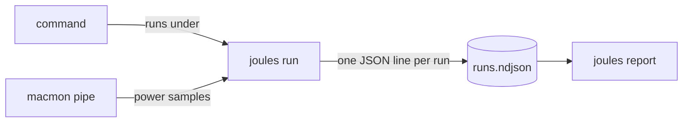

<!-- readme:header:start -->
<p>
  
  
</p>
<!-- readme:header:end -->

# joules

> Measures how many joules a command costs on an Apple Silicon Mac, with no sudo, by sampling SoC power while it runs.

<!-- readme:status:start -->
**Active**. I work on it this month.
<!-- readme:status:end -->



## Why

I wanted to know what a task costs in energy, not only in seconds: speech-to-text, hand tracking and a local LLM all
run on my Mac, and watts-over-time is the number that decides whether they can run all day. `powermetrics` needs
sudo. [macmon](https://github.com/vladkens/macmon) reads the same counters without it, so this wraps it.

## What it does

- `joules run --label L -- <cmd>` samples power with `macmon pipe` while `<cmd>` runs and appends one JSON line to `runs.ndjson`: total, CPU, GPU and ANE joules, average watts, seconds.
- `joules idle --seconds 30` takes a baseline; `--pair-idle S` measures S seconds of idle before and after the run and subtracts their mean, which follows background-load drift.
- `tokens=N` printed on the command's stdout is recorded, giving joules per token.
- `joules report` prints median, min, max and spread per label.

Not here: Linux or Intel Macs, per-process attribution (it measures the whole SoC), a powermetrics cross-check.

## Quick start

macOS on Apple Silicon, with [macmon](https://github.com/vladkens/macmon) installed (`cargo install macmon`):

```bash
python3 joules.py idle --seconds 30
python3 joules.py run --pair-idle 6 --label sleep -- sleep 5
python3 joules.py report
python3 -m unittest
```

The three example tasks (whisper.cpp, MediaPipe hands, mlx-lm) install once with `scripts/setup.sh` into
`~/joules-spike/env`, then `scripts/measure_all.sh` runs them offline; `scripts/check_nonet.sh` checks that they do.

## Numbers

M1, macOS 27.0.1, on battery, a live desktop in use. Net joules are the run minus the paired idle baseline. Raw rows
are in `results/`.

| task | n | seconds | net J median | spread (max-min / median) | note |
|---|---|---|---|---|---|
| hands (MediaPipe, 60 s of 30 fps synthetic frames) | 5 | 61.0 | 156.9 | 50.3% | 2026-11-24 rerun |
| llm (mlx-lm Qwen2.5-0.5B 4-bit, 200 tokens) | 5 | 3.6 | 22.1 | 47.3% | 0.110 J/token; rerun |
| stt (whisper.cpp base.en, one clip) | 5 | 0.8 | 3.0 | 277% | rerun; 1.4 to 9.7 J |
| noop (`sleep 5`) | 3 | 5.0 | -1.0 | n/a | range -3.7 to 11.9 J |

The earlier run (`results/runs.v2-paired6s.ndjson`) was tighter: hands 139.1 J (18.6%), llm 20.3 J (5.6%),
stt 3.03 J (16.0%), noop 0.73 J with one outlier. The 2026-11-24 rerun was not on a quiet Mac: load average was 4 to 8
(a browser and other desktop apps running), and it got worse.

What still does not pass:

- **Repeatability within 10%.** Only the first-run `llm` (5.6%) met it; the rerun does not for any task.
- **Noop.** A 5 s `sleep` should net about 0 J. It nets between -3.7 and 11.9 J, so the floor on a busy machine is about ±5 J: results under ~10 J (stt) are not distinguishable from noise there.
- **ANE reads 0.00 W** on every task, including ones that cannot use it. Whether macmon's ANE counter works on this chip is unverified.
- **powermetrics cross-check not run.** It needs sudo, which the Mac does not grant non-interactively. The joules are macmon's, uncalibrated against a second source.
- **Hands finds no hands.** The frames are synthetic noise (`hands_found=0`), so the cost is that of the detector searching, not tracking.

## Docs

`CLAUDE.md` holds the rules for agents working here.

<!-- readme:footer:start -->
---

<sub>Made by [Yehor Hrabovskyi](https://hrabovskyi.online) · [MIT licence](LICENSE).</sub>
<!-- readme:footer:end -->
